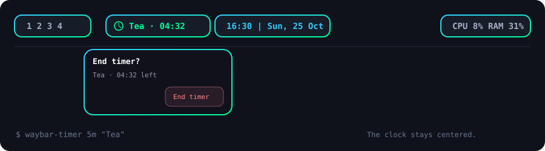

# Waybar Timer

A quiet desktop timer that agents and people control through the same CLI.

Start a timer, see the countdown beside your clock, and hear a short chime when it ends.
The Waybar module disappears when no timer is active. No account, API key, or network service is needed.



```sh
waybar-timer 5m "Tea"
waybar-timer status --json
```

## Features

- The timer stays hidden until you need it.
- The clock can stay centered, with the timer immediately to its left.
- The alarm continues after the terminal or Waybar closes.
- One chime marks completion. The completed timer stays visible until you dismiss it.
- An active timer has a small confirmation popup with one **End timer** button.
- Agents get the same CLI, JSON status, and a [ready-to-use skill](skills/desktop-timer/SKILL.md).
- The core uses the Python standard library. The popup is optional.

## Install on Arch Linux

### 1. Install the dependencies

The CLI, Waybar module, and sound need:

```sh
sudo pacman -S --needed git python waybar libpulse
```

For the confirmation popup, also install:

```sh
sudo pacman -S --needed python-gobject gtk4 gtk4-layer-shell
```

For the timer icons, use a Nerd Font. This font matches the example:

```sh
sudo pacman -S --needed ttf-jetbrains-mono-nerd
```

`paplay` from `libpulse` works with PulseAudio and PipeWire's PulseAudio compatibility service.
The timer also supports `pw-play` from `pipewire-audio` as a fallback.
The popup needs a Wayland compositor with layer-shell support, such as Hyprland or Sway.
The CLI needs Linux and Python 3.11 or later.

### 2. Install the timer

Clone the repository and install the timer:

```sh
git clone https://github.com/KeganHollern/waybar-timer.git
cd waybar-timer
python3 install.py --with-skill
```

The installer copies the runtime to `~/.local/share/waybar-timer` and creates `~/.local/bin/waybar-timer`.
`--with-skill` also makes a regular copy in `~/.agents/skills/desktop-timer`.
Omit that flag if you do not want a personal agent skill.
The installed timer works even if you move or remove the source checkout.

Make sure `~/.local/bin` is in your shell's `PATH`:

```sh
export PATH="$HOME/.local/bin:$PATH"
waybar-timer --help
```

Add the `export` line to your shell startup file if needed.
The installer supports `XDG_DATA_HOME` and `XDG_STATE_HOME`.
Use `--bin-dir`, `--data-dir`, and `--skill-dir` to choose other directories.

### 3. Add the Waybar module

Copy the supplied stylesheet:

```sh
mkdir -p ~/.config/waybar
cp timer.css ~/.config/waybar/waybar-timer.css
```

Add this line near the top of your Waybar `style.css`:

```css
@import url("waybar-timer.css");
```

Copy the module definitions from [examples/waybar-modules.jsonc](examples/waybar-modules.jsonc) into your Waybar config.
For a basic layout, add `custom/timer` to a module list.

To keep the clock centered, put the spacer and timer after your current left-side modules:

```jsonc
"expand-left": true,
"fixed-center": true,
"modules-left": [
    // Keep your current left-side modules here.
    "custom/timer-spacer",
    "custom/timer"
],
"modules-center": ["clock"]
```

The spacer fills the unused space between your left-side modules and the timer.
The clock stays centered when the timer appears, changes width, or disappears.
The supplied CSS has its own colors and needs no theme variables.

Reload Waybar:

```sh
pkill -USR2 -x waybar
```

### 4. Try a timer

```sh
waybar-timer sound-test
waybar-timer 5s "First timer"
```

The timer counts down, plays a chime, and stays visible. Click it to dismiss it.
While a timer is active, a click opens the **End timer** confirmation.
Click outside the popup or press Escape to keep the timer active.

## Commands

| Command | Result |
| --- | --- |
| `waybar-timer 10m "Tea"` | Start a timer with a label. |
| `waybar-timer start 1h30m "Laundry"` | Use the explicit start command. |
| `waybar-timer status` | Show the label and time left. |
| `waybar-timer status --json` | Get machine-readable state. |
| `waybar-timer cancel` | Stop and remove the current timer. |
| `waybar-timer dismiss` | Remove a completed timer. |
| `waybar-timer 5m "Break" --replace` | Replace the current timer. |
| `waybar-timer 5m --silent` | Start a timer without sound. |
| `waybar-timer 5m --sound /path/to/chime.wav` | Select another sound. |
| `waybar-timer sound-test` | Play the completion chime now. |

Durations accept `45s`, `10m`, `1h30m`, `1d`, and quoted combinations such as `"1h 5m 30s"`.
Bare numbers mean minutes. `02:30` means 2 minutes and 30 seconds. `1:02:30` means 1 hour, 2 minutes, and 30 seconds.
The range is 1 second to 366 days. Labels can contain up to 200 characters.

There is one active timer. A new timer needs `--replace` if another timer is active.
The bar shows up to 24 label characters. The tooltip and JSON status keep the full label.
The internal `watch` command provides Waybar's JSON stream. `click` handles the popup and dismissal.

## Use with agents

The skill is in [skills/desktop-timer/SKILL.md](skills/desktop-timer/SKILL.md).
It explains duration formats, status checks, replacement, and cancellation.
The installer's `--with-skill` option makes a separate personal copy in `~/.agents/skills`.
An agent that supports a different skills directory can use another copy there.

No special integration is necessary. An agent can run:

```sh
waybar-timer start 25m "Focus"
waybar-timer status --json
```

An agent does not need to stay active while the timer runs.

## Popup position and appearance

On Hyprland, the default popup opens below Waybar at the click position.
Other supported Wayland compositors use a position near the top center of the monitor.
The popup closes when its timer ends or another timer replaces it.
A stale confirmation cannot cancel the new timer.

Optional settings belong in `~/.config/waybar-timer/config.toml`, or under `XDG_CONFIG_HOME`.
[examples/popup.toml](examples/popup.toml) shows the available settings.
Use `centered-clock` anchoring only when your clock is centered and the timer is immediately to its left.
Set its font, clock format, and widths to match your own Waybar theme.

Edit `timer.css` for the bar colors. The popup styles are in the installed `assets/popup.css`.
An update replaces installed runtime assets, so keep your changes in your source copy if you customize them.

## State, sound, and suspend

State and logs live in `~/.local/state/waybar-timer`, or under `XDG_STATE_HOME`.
The idle display waits for a file change. It does not poll continuously.
The active alarm uses a separate process and survives a terminal or Waybar restart.

The timer counts suspend time. If it ends during suspend, the chime plays after the computer wakes.
After a reboot, Waybar resumes the saved timer from its wall-clock deadline.
The timer cannot play audio while the computer is off or suspended.
Audio uses the default output and its current volume.

If the sound fails, check `worker.log` and run `waybar-timer sound-test`.
If the popup fails, check `popup.log` and the optional GTK dependencies.

## Update or remove

Run `python3 install.py --with-skill` from a newer source checkout to update the installed files.
The installer saves previous files under the timer's state directory.
It refuses to overwrite unexpected edits. `--force` makes a backup before it replaces them.
This flag also supports migration from an older checkout-linked command.

To remove the installation, run this command from the source checkout:

```sh
python3 uninstall.py
```

Use `--keep-skill` to retain the personal skill.
Remove the timer module, spacer, and stylesheet import from your Waybar config, then reload Waybar.
The uninstaller keeps your state, logs, source checkout, and Waybar settings.
If you used `--data-dir`, pass the same directory to the uninstaller.

## Development

Run the tests without a desktop session, audio server, or third-party Python packages:

```sh
python3 -m unittest discover -s tests -v
```

The tests use temporary directories and substitute audio players.
They cover timer state, concurrency, stale confirmations, installation, updates, and removal.
GitHub Actions runs the suite on Python 3.11 through 3.14.
See [CONTRIBUTING.md](CONTRIBUTING.md) for the project structure and test expectations.

## License

Waybar Timer uses the [MIT license](LICENSE).
The chime and preview artwork are original project assets. Run `python3 make_sound.py` to create the chime again.
